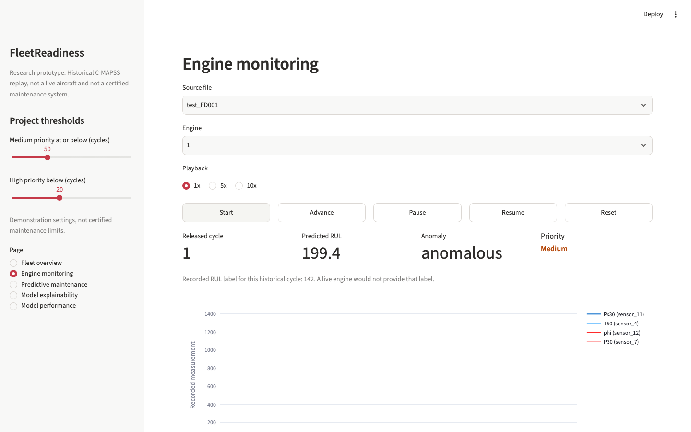
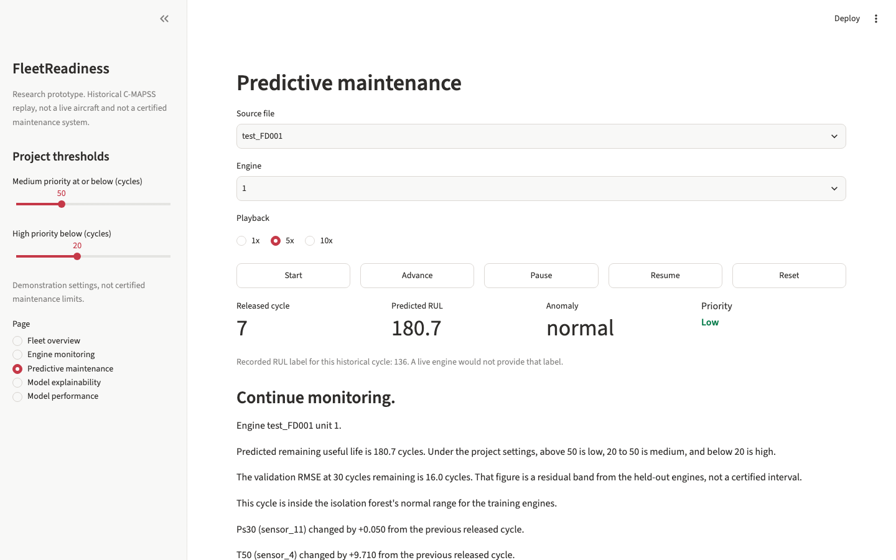
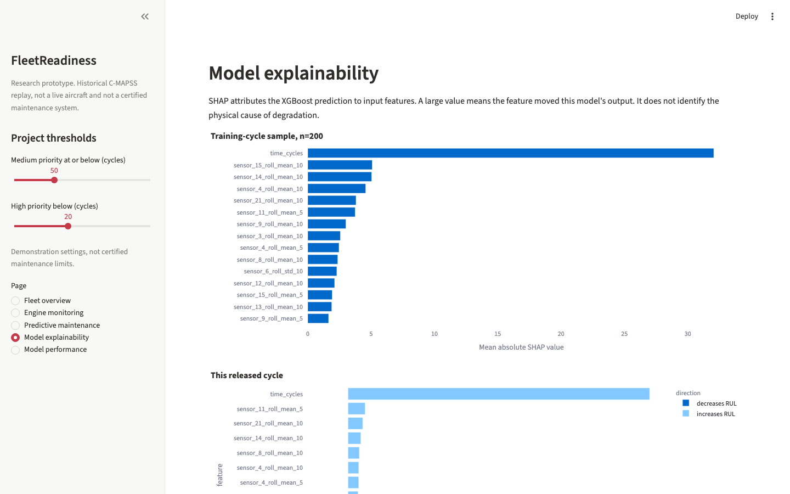
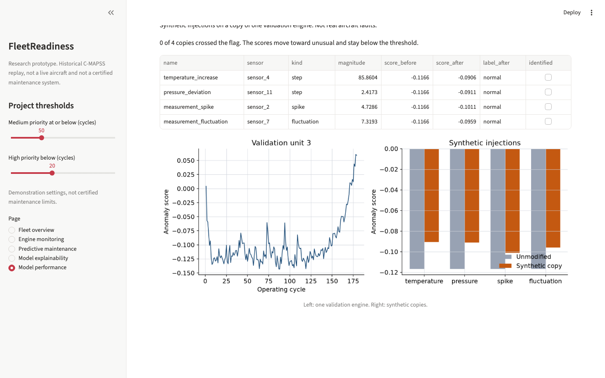

# How to use FleetReadiness

Open the app, press Start, then press Advance. Each click plays the next saved run of one engine. The guess and the note update from the runs you have played.

## Contents

- [Open the app](#open-the-app)
- [The five pages](#the-five-pages)
- [Walk one engine](#walk-one-engine)
- [The buttons](#the-buttons)
- [The other pages](#the-other-pages)
- [If the page is empty](#if-the-page-is-empty)

Words used on the screen are defined in the manual: [a cycle](docs/manual.md#what-a-cycle-is), [an anomaly score](docs/manual.md#anomaly-scores), and [the maintenance note](docs/manual.md#the-maintenance-note).

## Open the app

You need the app running first:

```bash
source .venv/bin/activate
streamlit run dashboard/app.py
```

Open [http://localhost:8501](http://localhost:8501).

The left side stays the same on every page. The two sliders are the demo cutoffs: medium at 50 runs left, high below 20. Moving them changes the note. It does not retrain the model.

## The five pages

| Page | What it is for |
|---|---|
| Fleet overview | The 100 test engines, each scored at its last saved run. |
| Engine monitoring | Play one engine, one run at a time. |
| Predictive maintenance | The note for the run you have reached, and the reasons. |
| Model explainability | Which inputs moved the guess. |
| Model performance | How far the guesses missed, and the four made-up sensor changes. |

## Walk one engine

1. Open **Engine monitoring**.
2. Leave **Source file** on `test_FD001` and **Engine** on `1`.
3. Leave playback on **1x**.
4. Press **Start**.

You are on run 1 of 31.

| On screen | What it means |
|---|---|
| Released cycle **1** | The first saved run of this engine. |
| Predicted RUL **199.4** | The model guesses about 199 runs are left. |
| Anomaly **anomalous** | This run looks unusual next to the teaching engines. |
| Priority **Medium** | The life guess is still high, so the band would be Low. The unusual flag lifts the note by one step. |
| Recorded RUL **142** | The answer saved in the file. A live engine would not come with that number. |



5. Press **Advance** once. You move to run 2. The guess is about 231, the flag is off, and the note drops to Low.
6. Switch playback to **5x** and press **Advance** once. One click now releases 5 runs, so you land on run 7.

Open **Predictive maintenance**. The same run is written out as a note.



At run 7 the note says **Continue monitoring.** Under it:

- The guess is about 181 runs. More than 50 is low, 20 to 50 is medium, under 20 is high.
- The check engines missed by about 16 runs. That 16 is a band around the guess, not a certified range.
- This run is inside the usual range.
- Four sensors are listed with how much they changed since the previous played run.

## The buttons

| Button | What it does |
|---|---|
| Start | Plays the first run. If you already started, it stays where you are. |
| Advance | Plays the next 1, 5, or 10 runs, matching the speed you picked. |
| Pause | Stops a running playback. |
| Resume | Keeps releasing runs on its own. Use Advance when you want to watch one step. |
| Reset | Goes back to before the first run. |

**1x**, **5x**, and **10x** are how many runs each Advance releases. The chart only draws runs you have already played.

The four lines are four sensors. One temperature sits near 1,400. The other three are much smaller numbers, so they sit near the bottom of the same chart.

## The other pages

**Fleet overview** is the list. Average guess **88.2** runs left. **29** engines are medium or high. **0** last runs are flagged unusual. Engine 34, near the top, is guessed at about **4** runs and the note is high.

**Model explainability** has two charts. The top chart is 200 teaching runs. The long bar is the run count: it moves the guess by about 32 runs. The bottom chart is the run you have played. A bar to the right pushed the guess up. A bar to the left pushed it down. The bars explain the model. They do not name a broken part.



**Model performance** shows the three models on the check engines, then the final exam: a typical miss of about 22 runs, and the large NASA score. Scroll to the bottom for the unusual-reading checks. The line there says **0 of 4** made-up changes crossed the alarm.



## If the page is empty

The first load reads the saved table and the models. Give it a few seconds. If the browser cannot connect, the app is not running. From the project folder:

```bash
source .venv/bin/activate
streamlit run dashboard/app.py
```

[Contents](#contents) · [Instruction manual](docs/manual.md)
