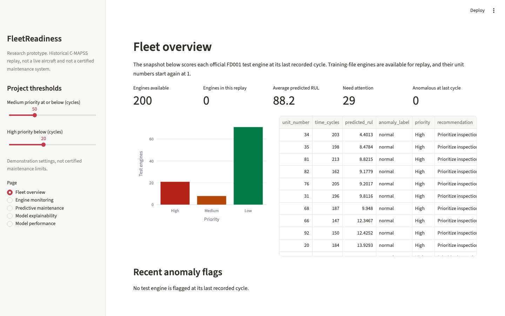
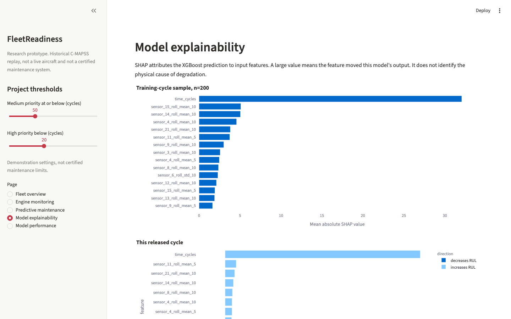
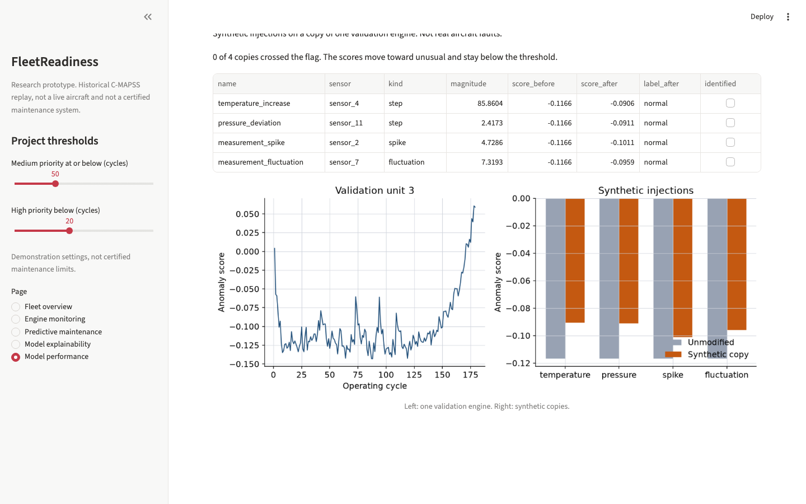

# FleetReadiness

A practice tool that plays saved jet-engine runs, guesses how many runs are left, and writes a short maintenance note.

The engines are NASA’s C-MAPSS simulation, subset FD001. Every run is at sea level. The screen is a replay of those saved runs. It is a portfolio project, and the notes are for the demo.

[How to use it](HOW_TO_USE.md) · [Technical notes](docs/technical-notes.md) · [Demo video](demo/fleetreadiness-demo.webm)



## Why this is useful

If every engine is inspected on a fixed schedule, healthy engines get opened anyway. If you wait for a failure, the engine stops during use.

The saved runs sit between those two choices. After each run the app guesses how many runs are left and sorts the engines:

- Engine 34 is guessed at about 4 runs left, so it goes to the front of the list.
- An engine guessed at 180 runs stays at the back.
- The maintenance page says why: the guess, the 50 and 20 cutoffs, and whether the readings look unusual.

The guesses miss by about 22 runs on the final exam, and four made-up sensor changes never tripped the alarm. The useful part of this copy is that a person can click through the whole path and see those limits on the screen.

## What a cycle is

A cycle is one run of the engine. The file saves one row of sensor readings from that run.

The next cycle is the next run. The engine is a little more worn, the sensors are written down again, and that becomes the next row. “180 cycles left” means about 180 more of these runs until the simulated failure.

## The two files of engines

| File | Engines | What happened |
|---|---:|---|
| Training | 100 | Run until the simulated engine failed. The last run is the failure. |
| Test | 100 | Stopped early. A second file says how many runs were still left. |

Unit number 1 exists in both files. They are different engines. The **Source file** menu is how you tell them apart.

On the fleet page, 200 engines are in the menus. The table scores only the 100 test engines, each at its last saved run. The average guess there is **88.2 runs** left. **29** engines are marked for attention. **0** of those last runs are flagged as unusual.

## What the model is allowed to see

For each sensor that actually changes, every run keeps:

- the reading on this run
- the change since the previous run
- the average of the last 5 runs, and how much those 5 bounced
- the same two numbers over the last 10 runs

That is 93 numbers. Six sensors never move in this file, so they were left out. One setting is always 100, so it was left out too.

On run 7 the model can see runs 1 through 7. It cannot see run 8.

The 100 training engines were split by whole engine: **80** to teach, **20** to check. The 100 test engines were the final exam, scored once, after the model was already chosen.

## How many runs are left

Three models were taught the same job. They were compared on the 20 check engines, on the run where 30 runs were really left. The smaller miss won.

| Model | Typical size of the miss |
|---|---:|
| Ridge, the simple one | about 32 runs |
| Random forest | about 16 runs |
| XGBoost | about 16 runs |

XGBoost was a little closer, so the app uses that one.

On the last saved run of each of the 100 test engines:

- The typical miss is about **22 runs**.
- The guess is usually a bit high, by about **13 runs** on average.
- The NASA score is **921,535**. That score gets huge when a guess is far too high. Test engine 67 was guessed at about **214** runs when **77** were left. That one miss is almost the whole score. The middle miss is about **9 runs** too high.

The model leans on how many runs have already happened. On 200 teaching runs, the run count moves the guess by about **32 runs**. The next clues are recent averages of a few sensors, about **4 or 5 runs** each. Those bars explain the model. They do not name the cause of the wear.



## Unusual readings

A second model only saw the 80 teaching engines. Nobody labeled the faults for it. It learned what a usual teaching run looks like.

A higher score is more unusual. The alarm line is **0**. A negative score is still called normal.

| Check | What was replayed | Result |
|---|---|---|
| Early runs | 1,832 check runs with more than 100 runs still left | 0.8% flagged. Average score about −0.11. |
| One engine wearing down | Check engine 3, first run through the last | Score climbs from about −0.11 to about −0.01. About 6% of its runs are flagged. |
| Four made-up edits | A copy of engine 3, edited from run 125 | Scores move a little. 0 of 4 cross the alarm. |

The made-up edits were each 10 times the normal bounce of that sensor. The real file was not changed.

| What we changed | How big | Score after | Alarm |
|---|---:|---:|---|
| Temperature, sensor 4, raised and left high | +85.9 | −0.091 | No |
| Pressure, sensor 11, raised and left high | +2.4 | −0.091 | No |
| Temperature, sensor 2, spiked for one run | +4.7 | −0.101 | No |
| Pressure, sensor 7, wiggled up and down | +7.3 | −0.096 | No |

The last row is the measurement fluctuation. The score started at −0.117. It moved to −0.096 and stayed under the alarm. This checker looks at all 93 numbers at once, so one sensor, even a large change, was not enough.



## The maintenance note

The note uses the guess of runs left.

| Runs left | Priority | Note |
|---|---|---|
| More than 50 | Low | Continue monitoring. |
| 20 to 50 | Medium | Schedule an inspection. |
| Fewer than 20 | High | Inspect soon and look at the sensors that contributed. |

Two extra rules can raise the note. The check engines missed by about **16 runs** when 30 were left. If the bottom of that band falls under 20, the note becomes High. If the unusual-reading alarm is on, the note goes up one step. The screen says the alarm means the pattern looks unusual. It does not say a part has broken.

The sliders change the 50 and the 20. They do not retrain the model.

## Run it

Python 3.12. On macOS, XGBoost needs `brew install libomp`.

```bash
python3.12 -m venv .venv
source .venv/bin/activate
python -m pip install -r requirements.txt
streamlit run dashboard/app.py
```

Then open [http://localhost:8501](http://localhost:8501). The click-by-click guide is [How to use FleetReadiness](HOW_TO_USE.md).

The saved models and the processed table are already in the repo, so the screen works without training again. Dataset source, column names, and the exact scores are in the [technical notes](docs/technical-notes.md).

## Limits

- FD001 is one sea-level condition and one kind of damage.
- The guess often says too many runs are left, and one bad guess dominates the NASA score.
- The unusual-reading model had no fault labels. The four made-up changes were not flagged.
- The 50 and the 20 were chosen for this demo.
- The screen replays saved rows. It is not connected to an airplane.
