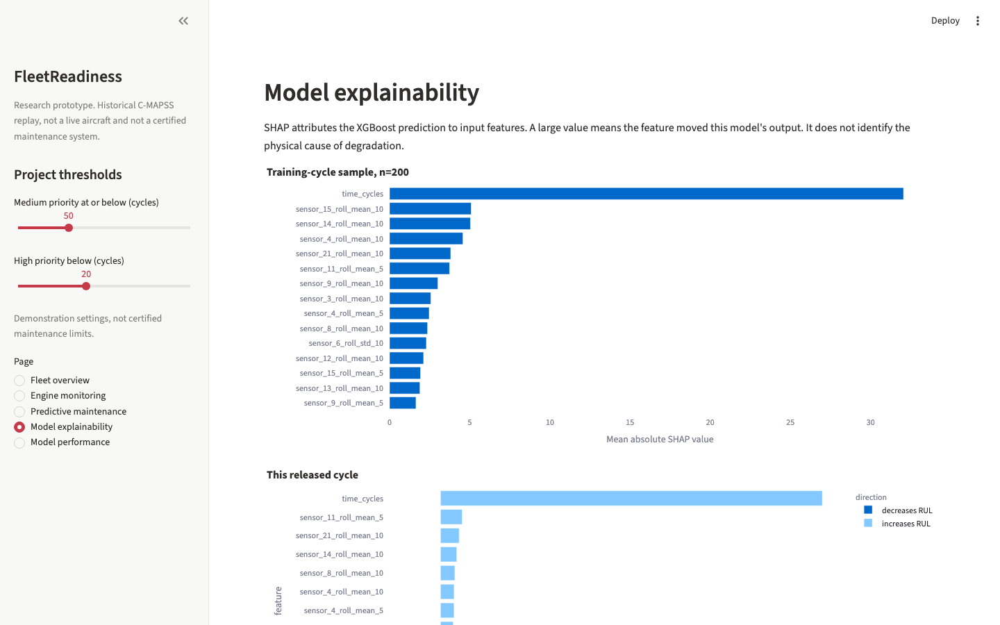
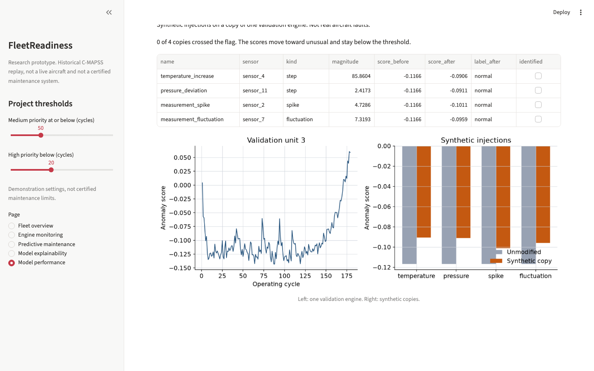

# Instruction manual

Plain-language notes for FleetReadiness. Each item below opens that part of the manual.

## Contents

1. [What this is](#what-this-is)
2. [Why it is useful](#why-it-is-useful)
3. [What a cycle is](#what-a-cycle-is)
4. [The engine files](#the-engine-files)
5. [What the model is allowed to see](#what-the-model-is-allowed-to-see)
6. [How many runs are left](#how-many-runs-are-left)
7. [Anomaly scores](#anomaly-scores)
8. [The four made-up changes](#the-four-made-up-changes)
9. [The maintenance note](#the-maintenance-note)
10. [Using it with other things](#using-it-with-other-things)
11. [Using the screen](#using-the-screen)
12. [Limits](#limits)
13. [Where the exact numbers live](#where-the-exact-numbers-live)

[Back to the project page](../README.md)

## What this is

FleetReadiness plays saved jet-engine runs, guesses how many runs are left, and writes a short maintenance note.

The engines are NASA’s C-MAPSS simulation, subset FD001. Every run is at sea level. The screen is a replay of those saved runs. It is a portfolio project, and the notes are for the demo.

[Contents](#contents)

## Why it is useful

If every engine is inspected on a fixed schedule, healthy engines get opened anyway. If you wait for a failure, the engine stops during use.

The saved runs sit between those two choices. After each run the app guesses how many runs are left and sorts the engines:

- Engine 34 is guessed at about 4 runs left, so it goes to the front of the list.
- An engine guessed at 180 runs stays at the back.
- The maintenance page says why: the guess, the 50 and 20 cutoffs, and whether the readings look unusual.

The guesses miss by about 22 runs on the final exam, and four made-up sensor changes never tripped the alarm. The useful part of this copy is that a person can click through the whole path and see those limits on the screen.

[Contents](#contents)

## What a cycle is

A cycle is one run of the engine. The file saves one row of sensor readings from that run.

The next cycle is the next run. The engine is a little more worn, the sensors are written down again, and that becomes the next row. “180 cycles left” means about 180 more of these runs until the simulated failure.

For FD001, every run is the same kind of operation: sea level. The damage in this file is in the high-pressure compressor. The engine is run again under that one condition, and the file stores the readings for that run.

[Contents](#contents)

## The engine files

| File | Engines | What happened |
|---|---:|---|
| Training | 100 | Run until the simulated engine failed. The last run is the failure. |
| Test | 100 | Stopped early. A second file says how many runs were still left. |

On a training engine, runs left at a given run are `last run minus this run`. The last run has 0 left.

Unit number 1 exists in both files. They are different engines. The **Source file** menu is how you tell them apart. Test engine 1 was recorded for 31 runs.

On the fleet page, 200 engines are in the menus. The table scores only the 100 test engines, each at its last saved run. The average guess there is **88.2 runs** left. **29** engines are marked for attention. **0** of those last runs are flagged as unusual.

[Contents](#contents)

## What the model is allowed to see

For each sensor that actually changes, every run keeps:

- the reading on this run
- the change since the previous run
- the average of the last 5 runs, and how much those 5 bounced
- the same two numbers over the last 10 runs

That is 93 numbers. Six sensors never move in this file, so they were left out. One setting is always 100, so it was left out too.

On run 7 the model can see runs 1 through 7. It cannot see run 8.

The 100 training engines were split by whole engine: **80** to teach, **20** to check. A run from a teaching engine never appears in the check set. The 100 test engines were the final exam, scored once, after the model was already chosen.

[Contents](#contents)

## How many runs are left

Three models were taught the same job. They were compared on the 20 check engines, on the run where 30 runs were really left. The smaller miss won.

| Model | Typical size of the miss |
|---|---:|
| Ridge, the simple one | about 32 runs |
| Random forest | about 16 runs |
| XGBoost | about 16 runs |

XGBoost was a little closer, so the app uses that one.

On the last saved run of each of the 100 test engines:

- The typical miss is about **22 runs**.
- The guess is usually a bit high, by about **13 runs** on average.
- The NASA score is **921,535**. That score gets huge when a guess is far too high. Test engine 67 was guessed at about **214** runs when **77** were left. That one miss is almost the whole score. The middle miss is about **9 runs** too high.

The model leans on how many runs have already happened. On 200 teaching runs, the run count moves the guess by about **32 runs**. The next clues are recent averages of a few sensors, about **4 or 5 runs** each. Those bars explain the model. They do not name the cause of the wear.

The screen for this chart is [Model explainability](../HOW_TO_USE.md#the-other-pages).

[Contents](#contents)

## Anomaly scores

Each run gets an anomaly score. The score says how unusual that run looks next to the 80 teaching engines. A higher number is more unusual. The alarm line is **0**.

The model was not given a list of faults. It only saw the teaching runs, in the same 93 numbers the life model uses. About 2% of those teaching runs were set aside as the unusual tail, and that is what placed the line at 0.

| Score | What the screen says |
|---|---|
| Below 0 | Normal. A usual run. |
| About −0.11 | Where early check runs sit. |
| About −0.01 | Where the last runs of a wearing engine sit. Still under the line. |
| Above 0 | Anomalous. The alarm is on. |

The alarm turns on only when the score goes above 0. On the fleet page, none of the 100 test engines are above 0 at their last saved run.

One run is 93 numbers at once. Changing a single sensor, even by a lot, often leaves the rest of the pattern looking like the teaching engines. The score can move toward 0 without crossing it.

| Check | What was replayed | Result |
|---|---|---|
| Early runs | 1,832 check runs with more than 100 runs still left | 0.8% flagged. Average score about −0.11. |
| One engine wearing down | Check engine 3, first run through the last | Score climbs from about −0.11 to about −0.01. About 6% of its runs are flagged. |
| Four made-up edits | A copy of engine 3, edited from run 125 | Scores move a little. [0 of 4](#the-four-made-up-changes) cross the alarm. |

If the alarm is on, the [maintenance note](#the-maintenance-note) goes up one step. The screen says the pattern looks unusual. It does not say a part has broken.

[Contents](#contents)

## The four made-up changes

These edits were made on a copy of check engine 3, starting at run 125. Each change is 10 times the normal bounce of that sensor on that engine. The real file was not changed. Every score started at **−0.117**.

| What we changed | How big | Score after | Alarm |
|---|---:|---:|---|
| Temperature, sensor 4, raised and left high | +85.9 | −0.091 | No |
| Pressure, sensor 11, raised and left high | +2.4 | −0.091 | No |
| Temperature, sensor 2, spiked for one run | +4.7 | −0.101 | No |
| Pressure, sensor 7, wiggled up and down | +7.3 | −0.096 | No |

The last row is the measurement fluctuation. Sensor 7 is a pressure reading. On the copy, that pressure was wiggled by about 7 units. The score moved from −0.117 to −0.096 and stayed under the [alarm line](#anomaly-scores).

[Contents](#contents)

## The maintenance note

The note uses the guess of runs left.

| Runs left | Priority | Note |
|---|---|---|
| More than 50 | Low | Continue monitoring. |
| 20 to 50 | Medium | Schedule an inspection. |
| Fewer than 20 | High | Inspect soon and look at the sensors that contributed. |

Two extra rules can raise the note.

- The check engines missed by about **16 runs** when 30 were left. The app treats that 16 as a band around the guess. If the bottom of the band falls under 20, the note becomes High.
- If the [anomaly score](#anomaly-scores) is above 0, the note goes up one step. Low becomes Medium. Medium becomes High.

The sliders on the screen change the 50 and the 20. They do not retrain the model. How to read a note on a live replay is in [Walk one engine](../HOW_TO_USE.md#walk-one-engine).

[Contents](#contents)

## Using it with other things

The app takes one row per engine run and writes a note: keep watching, plan an inspection, or inspect this one first. Something else either hands it those rows, or takes the note.

**Other engine files.** FD002, FD003, and FD004 are the same kind of NASA runs. Some have more than one operating condition, and two of them add a second kind of damage. The same screens can replay those after the models are taught on them. The FD001 guesses are for FD001.

**A shop schedule.** The High note is the handoff. A calendar or a work-order list can turn “engine 34, about 4 runs left, inspect soon” into a date, a bay, and a person. This app stops at the sentence.

**Parts and cost.** A parts list can check whether the pieces are on the shelf. A cost sheet can compare an early inspection with the cost of the engine stopping in use. This app does not know prices or stock.

**A message when the note changes.** Mail or a chat channel can send the same sentence when an engine moves to High, or when the unusual-reading flag turns on.

**Another machine that wears in runs.** Pumps, gearboxes, and smaller turbines fit the same shape when each run is one row, the rows stay in order, and the teaching machines have a known failure run. The sensors would be that machine’s sensors. The 50 and the 20 would be chosen again.

**A test stand.** A stand that saves a row after each run can feed the same replay. The stand keeps recording. The app guesses from the rows it has already been given. Today those teaching rows are the NASA simulation.

[Contents](#contents)

## Using the screen

The click-through has its own page. Open the part you need:

- [Open the app](../HOW_TO_USE.md)
- [The five pages](../HOW_TO_USE.md#the-five-pages)
- [Walk one engine](../HOW_TO_USE.md#walk-one-engine)
- [The buttons](../HOW_TO_USE.md#the-buttons)
- [The other pages](../HOW_TO_USE.md#the-other-pages)
- [If the page is empty](../HOW_TO_USE.md#if-the-page-is-empty)

A 52-second replay of those screens is in the [demo video](../demo/fleetreadiness-demo.webm).

[Contents](#contents)

## Limits

- FD001 is one sea-level condition and one kind of damage.
- The guess often says too many runs are left, and one bad guess dominates the NASA score.
- The unusual-reading model had no fault labels. The four made-up changes were not flagged.
- The 50 and the 20 were chosen for this demo.
- The screen replays saved rows. It is not connected to an airplane.

[Contents](#contents)

## Where the exact numbers live

Dataset source, column names, the training split, and the full score tables are in the [technical notes](technical-notes.md).

[Contents](#contents)
