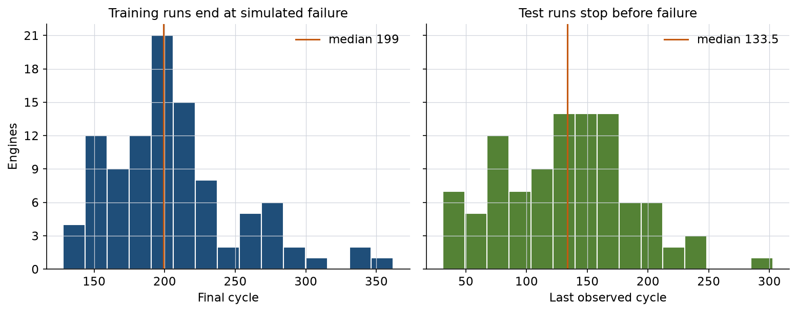
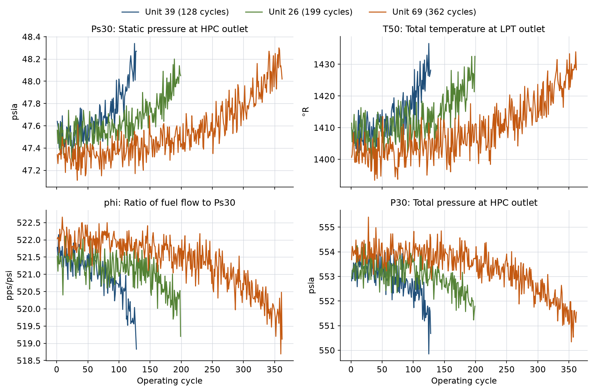
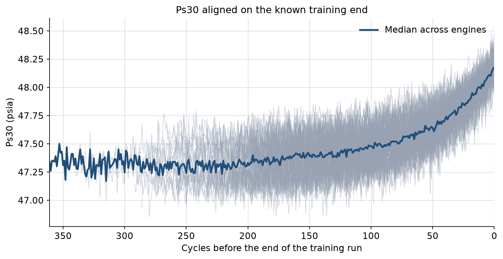
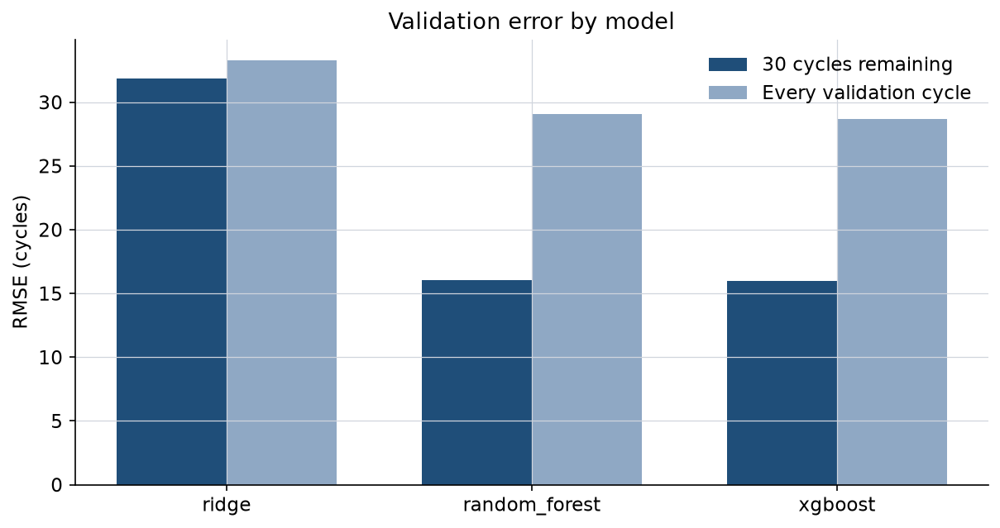
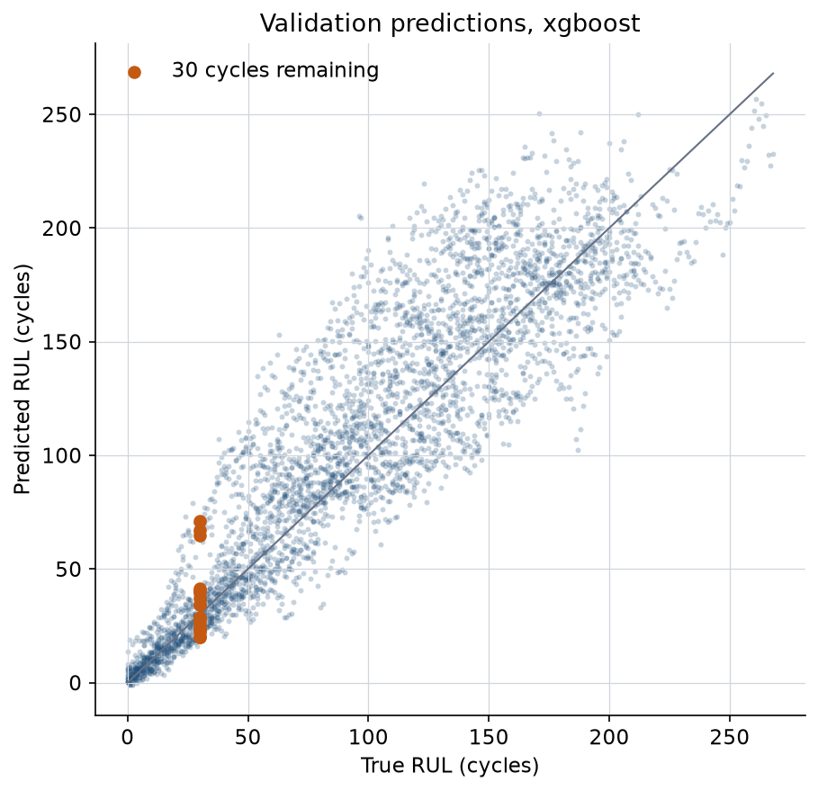
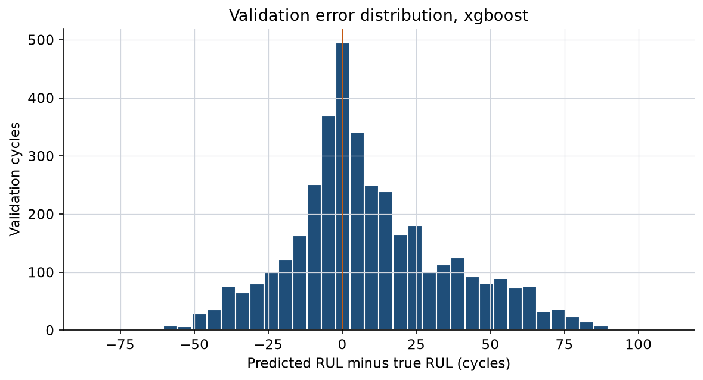
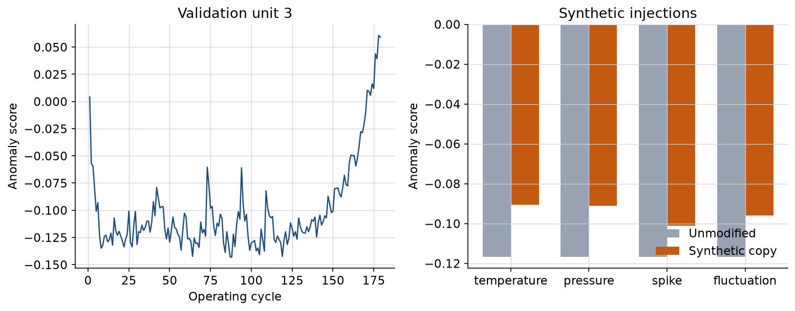

# Technical notes

The short guide is the [README](../README.md). The click-through is [How to use FleetReadiness](../HOW_TO_USE.md). This file keeps the dataset source, the column notes, and the exact model numbers.

## Setup notes

Python 3.12 is required.

```bash
python3.12 -m venv .venv
source .venv/bin/activate
python -m pip install -r requirements.txt
jupyter notebook notebooks/exploration.ipynb
```

On this Mac, Homebrew Python 3.12.16 could not import `plistlib` because `pyexpat` is linked against a `libexpat` that does not provide `_XML_SetAllocTrackerActivationThreshold`. `platform.mac_ver()` then returns empty strings, and current pip refuses that interpreter. The environment used for this phase was created from uv's standalone CPython instead:

```bash
uv python install 3.12
uv venv .venv --python 3.12
uv pip install -r requirements.txt
```

`requirements.txt` lists the packages used by the application: NumPy, pandas, Matplotlib, Jupyter, pytest, scikit-learn, XGBoost, Streamlit, Plotly, and SHAP. On macOS, XGBoost needs the OpenMP runtime (`brew install libomp`).

## Dataset

### Where the files came from

The NASA Open Data Portal catalog page is [CMAPSS Jet Engine Simulated Data](https://data.nasa.gov/dataset/cmapss-jet-engine-simulated-data). Its distribution URL is `https://data.nasa.gov/docs/legacy/CMAPSSData.zip`. That URL returned no bytes in this environment.

The files in `data/raw/` were downloaded from the Zenodo republication of the same Prognostics Center of Excellence archive:

- Record: [10.5281/zenodo.15346912](https://doi.org/10.5281/zenodo.15346912)
- File: `CMAPSSData.zip`
- Published MD5: `79a22f36e80606c69d0e9e4da5bb2b7a` (verified locally)
- Zenodo license: Creative Commons Attribution 4.0
- Citation: National Aeronautics and Space Administration. (2008). *PCoE Turbofan Engine Degradation Simulation* [Dataset]. NASA Diagnostics and Prognostics Group. https://doi.org/10.5281/zenodo.15346912

The archive also contains the original `readme.txt` and Saxena, Goebel, Simon, and Eklund, *Damage Propagation Modeling for Aircraft Engine Run-to-Failure Simulation*, PHM08, 2008. Both are stored, unmodified, in `data/raw/`.

The Hugging Face dataset `GAOCHAO1/nasa-cmapss-rul` was not used. It is a converted copy. Phase 1 needs the original space-separated text so the column layout can be checked against the readme.

To download the archive again:

```bash
mkdir -p data/raw
curl -fL -o data/raw/CMAPSSData.zip \
  "https://zenodo.org/records/15346912/files/CMAPSSData.zip?download=1"
md5 data/raw/CMAPSSData.zip   # expect 79a22f36e80606c69d0e9e4da5bb2b7a
unzip -o data/raw/CMAPSSData.zip -d data/raw
```

The zip contains all four subsets (FD001–FD004). Phase 1 reads FD001 only. The other files are kept and are not edited.

`readme.txt` is Windows-1252, not UTF-8. It is left as it shipped in 2008.

### What FD001 is

From `readme.txt`:

| | FD001 |
|---|---|
| Training trajectories | 100 |
| Test trajectories | 100 |
| Conditions | One (sea level) |
| Fault mode | One (HPC degradation) |

Each row is one engine at one operating cycle. Training series run until the simulated failure. Test series stop before failure. `RUL_FD001.txt` has one integer per test engine: the cycles remaining after the last observed cycle. Engines are stored in unit order `1..100`, and the RUL file follows that same order.

The readme states that engines start with different initial wear, that this wear is not a fault, that three operational settings affect performance, and that the measurements include sensor noise.

### Column layout

The files have no header. Every FD001 row has **26** whitespace-separated fields. The readme lists 26 columns and then calls column 26 "sensor measurement 26". That label is inconsistent with the file. Columns 1–5 are the unit, the cycle, and three settings, so columns 6–26 are **21 sensor channels**. The paper states that 21 simulator outputs were provided as the sensor data. There is no sensor 22–26.

| Column | Name used here | What the documentation says |
|---|---|---|
| 1 | `unit_number` | Readme: unit number |
| 2 | `time_cycles` | Readme: time, in cycles |
| 3 | `op_setting_1` | Readme: operational setting 1. No physical name is given. |
| 4 | `op_setting_2` | Readme: operational setting 2. No physical name is given. |
| 5 | `op_setting_3` | Readme: operational setting 3. No physical name is given. |
| 6–26 | `sensor_1` … `sensor_21` | Readme positions. Descriptions below are Saxena et al. Table 2, in the order that table lists the participant sensor channels. The file itself does not print these symbols. |

The paper says the simulated conditions are combinations of altitude, Mach number, and throttle resolver angle. It does not say which of the three setting columns is which. Those names are not assigned in this project.

Sensor descriptions, Saxena et al. 2008, Table 2, listed order:

| Column | Symbol | Description | Units |
|---|---|---|---|
| `sensor_1` | T2 | Total temperature at fan inlet | °R |
| `sensor_2` | T24 | Total temperature at LPC outlet | °R |
| `sensor_3` | T30 | Total temperature at HPC outlet | °R |
| `sensor_4` | T50 | Total temperature at LPT outlet | °R |
| `sensor_5` | P2 | Pressure at fan inlet | psia |
| `sensor_6` | P15 | Total pressure in bypass-duct | psia |
| `sensor_7` | P30 | Total pressure at HPC outlet | psia |
| `sensor_8` | Nf | Physical fan speed | rpm |
| `sensor_9` | Nc | Physical core speed | rpm |
| `sensor_10` | epr | Engine pressure ratio (P50/P2) | — |
| `sensor_11` | Ps30 | Static pressure at HPC outlet | psia |
| `sensor_12` | phi | Ratio of fuel flow to Ps30 | pps/psi |
| `sensor_13` | NRf | Corrected fan speed | rpm |
| `sensor_14` | NRc | Corrected core speed | rpm |
| `sensor_15` | BPR | Bypass ratio | — |
| `sensor_16` | farB | Burner fuel-air ratio | — |
| `sensor_17` | htBleed | Bleed enthalpy | — |
| `sensor_18` | Nf_dmd | Demanded fan speed | rpm |
| `sensor_19` | PCNfR_dmd | Demanded corrected fan speed | rpm |
| `sensor_20` | W31 | HPT coolant bleed | lbm/s |
| `sensor_21` | W32 | LPT coolant bleed | lbm/s |

## What Phase 1 found

Checked in `notebooks/exploration.ipynb`. Raw files were not rewritten.

| Check | FD001 result |
|---|---|
| Training rows | 20,631 across 100 engines |
| Test rows | 13,096 across 100 engines |
| Missing values | 0 in train and test |
| Duplicate unit-cycle rows | 0 |
| Cycle index | Every engine is `1, 2, ..., N` with no gaps |
| Training run length | 128 to 362 cycles; mean 206.31; median 199 |
| Shortest / median / longest training units | 39 (128), 26 (199), 69 (362) |
| Test observed length | 31 to 303 cycles; mean 130.96; median 133.5 |
| Test RUL after the last cycle | 7 to 145 cycles; mean 75.52 |

Training RUL at cycle `t` is `final cycle − t`. The failure cycle has label 0. That quantity is a label. It uses the end of the run, so it cannot be a model input, and neither can any later sensor row.

Test length and training length are different quantities. A test series was cut off on purpose.

Six channels are constant on every FD001 training row, and the same constants appear in the test file: `sensor_1`, `sensor_5`, `sensor_10`, `sensor_16`, `sensor_18`, and `sensor_19` (`T2`, `P2`, `epr`, `farB`, `Nf_dmd`, `PCNfR_dmd`). `sensor_6` (`P15`) takes only two values, 21.61 and 21.60. Operational setting 3 is exactly 100 on every FD001 row. Settings 1 and 2 stay in a narrow band around zero (setting 1 from −0.0087 to 0.0087, setting 2 from −0.0006 to 0.0006) and do not trend with cycle. That is consistent with the readme's single sea-level condition. It still does not identify the three settings.

Pooled Pearson correlation with the training RUL label is a screening statistic, not a cause and not a feature importance. The strongest associations are `sensor_11` (Ps30, −0.696), `sensor_4` (T50, −0.679), `sensor_12` (phi, +0.672), and `sensor_7` (P30, +0.657). Several other channels move as well. Aligned on the known end of each training run, Ps30 is fairly flat early and rises late. The readme's fault mode is HPC degradation. These plots do not identify a failed part, and they are not maintenance limits.







The aligned figure uses the failure cycle to place each engine on the same horizontal axis. A predictor running at an earlier cycle would not know that position.

## Layout

```text
data/raw/            original C-MAPSS archive and extracted files
data/processed/      FD001 feature table, split manifest, and training-set scaler
notebooks/           FD001 exploration notebook and figures
src/data/            loader, labels, engine split, normalization
src/features/        trailing rolling features and cycle-to-cycle differences
models/              saved RUL model, isolation forest, comparison, and SHAP summary
dashboard/app.py     Streamlit monitoring dashboard
tests/               processing, model, anomaly, simulator, and decision tests
```

## Processed FD001 data

Regenerate the processed files with:

```bash
python -m src.data.preprocessing
pytest
```

`data/raw/` is only read. The build checks that FD001 still has the same constant channels before it drops them from the model matrix.

| Output | Role |
|---|---|
| `data/processed/fd001_features.csv` | One row per cycle, in the original measurement units |
| `data/processed/fd001_feature_columns.json` | The 93 model inputs, in order |
| `data/processed/fd001_scaler.json` | Standard-score mean and standard deviation fit on the training engines |
| `data/processed/fd001_split.json` | Engine membership, exclusion decisions, and row counts |

The training file and the test file both number engines from 1. Those are different engines. Each processed row has `source_file` so the identity is `(source_file, unit_number)`.

### Labels

For an engine in `train_FD001.txt`, `rul = final cycle − current cycle`. The last cycle is 0.

For an engine in `test_FD001.txt`, `rul = (last observed cycle + RUL file value) − current cycle`. At the last observed cycle this equals the value in `RUL_FD001.txt`. The RUL column is a label. It is not one of the model inputs.

### Split

The 100 official test engines stay in `split = test` (13,096 rows). The 100 engines in the training file are divided by engine id, not by cycle. With seed 42, `floor(100 × 0.2) = 20` engines are `validation` (3,852 rows) and the other 80 are `train` (16,779 rows). Every cycle of an engine has the same split. The same seed reproduces the same membership.

### Features

For each of the 15 sensors that vary in FD001, the row at cycle t contains:

- the current reading
- the difference from the previous cycle of the same engine, with 0 at cycle 1
- the trailing mean over 5 and over 10 cycles
- the trailing standard deviation over 5 and over 10 cycles, using divisor n

A window at the start of a run is shorter. It is not filled with later cycles. The other model inputs are `time_cycles`, `op_setting_1`, and `op_setting_2`.

`sensor_1`, `sensor_5`, `sensor_10`, `sensor_16`, `sensor_18`, and `sensor_19` are constant on every FD001 training and test row. They stay in `data/raw/` and are omitted from the feature matrix. `sensor_6` takes two values, 21.61 and 21.60, and is retained. `op_setting_3` is 100 on every row. That column is kept in the CSV and omitted from the model inputs, because a constant has no standard deviation to scale by.

The CSV is unscaled, so the sensor values are still in the recorded units. `fd001_scaler.json` is a standard score fit on rows with `split == train` only. Validation and test rows do not enter the mean or the standard deviation. Applying that frozen scaler is `apply_standardizer` in `src/data/preprocessing.py`.

Tests cover the RUL formulas, the engine split, the constant-channel check, and the requirement that features at cycle t stay the same after every later cycle of that engine is deleted. One engine's history is not used to compute another's rolling values.

## RUL models

Retrain and rewrite the comparison with:

```bash
python -m src.models.rul_model
```

The fit uses the 80 training engines only. Inputs are the 93 standardized features. The label is uncapped `rul`. Hyperparameters are fixed in `src/models/rul_model.py`; they were not searched on the official test engines.

The model is chosen by RMSE on the validation engines at the single cycle where 30 cycles remain. That cycle is known because those runs continue to the recorded end. It is an evaluation slice, not a model input. The official test set is scored after that choice, and only the chosen model is scored there. The test score is the last observed cycle of each test engine, which is the C-MAPSS question.

| Model | Validation RMSE, 30 cycles left | Validation RMSE, every cycle | Validation NASA score, 30 cycles left |
|---|---:|---:|---:|
| Ridge regression | 31.85 | 33.26 | 1,113 |
| Random forest | 16.07 | 29.06 | 131 |
| XGBoost | 15.95 | 28.68 | 145 |

XGBoost is the saved model (`models/rul_model.pkl`). On the selection slice its MAE is 10.81 cycles. Random forest is close: its MAE there is 10.55 and its NASA score is lower. The selection rule was RMSE, so XGBoost is the one that was saved. Ridge is late on that slice, with a mean signed error of +25.6 cycles.

On every validation cycle the tree models have an RMSE near 29 cycles. The cloud is tight near the end of a run and wide when a lot of life remains. The error distribution sits a bit to the right of zero: XGBoost's mean signed error across validation cycles is +9.3 cycles, so the typical mistake is predicting too much life remaining.







Official test engines, last observed cycle, XGBoost only: MAE 21.77, RMSE 30.96, mean signed error +12.7 cycles. The NASA sum is 921,535. That sum is not a typical error. The penalty grows exponentially, and test engine 67 is predicted at 214 cycles when 77 remain. That one late prediction accounts for nearly the entire sum. The median signed error on the 100 test engines is +8.9 cycles.

Clipping the training label at 125 cycles, then scoring against the real uncapped label, did not improve the all-cycle error. Capped XGBoost's RMSE at 30 cycles remaining was 15.43, against 15.95 for the uncapped fit, and its all-cycle RMSE rose to 33.81. The cap was not eligible for selection.

The largest XGBoost impurity shares are `time_cycles`, then the 10-cycle means of sensors 15, 4, and 11 (`BPR`, `T50`, and `Ps30` in Table 2 order). Impurity share is not a physical cause. A large share for `time_cycles` means part of the prediction is how long the engine has already been running.

The asymmetric score follows Saxena et al. 2008, equation 11. `d` is estimated RUL minus true RUL. The paper sets a1 = 10 and a2 = 13 and says a late prediction is penalized more than an early one of the same size. The implementation uses 10 on positive `d` and 13 on negative `d`, which is the assignment that matches that sentence. A unit test checks the two penalties.

The largest SHAP contributions on a 200-cycle training sample are also led by `time_cycles`, then rolling means of sensors 15, 14, 4, and 21. SHAP explains the model. It does not identify a physical cause.

## Anomaly detection

An isolation forest is fit on the same 80 training engines and the same 93 standardized features. About 2% of those training cycles are treated as the unusual tail. The saved score is the negative of sklearn's decision function, so a higher score is more unusual. The model has no fault labels.

| Check | What was replayed | Result |
|---|---|---|
| A. Early operation | 1,832 unmodified validation cycles with recorded RUL above 100 | 0.8% flagged |
| B. Degradation path | Validation unit 3, first cycle through the recorded end | Score correlation with cycle 0.48. Mean score rises from −0.11 in the first 20 cycles to −0.01 in the last 20. 5.6% of its cycles are flagged. |
| C. Synthetic copies | Temperature step, pressure step, a spike, and added fluctuation on a copy of unit 3 | Scores move slightly toward unusual. 0 of 4 copies cross the flag threshold. |

Scenario C changes the copied measurements by ten standard deviations and rebuilds the rolling features. In this 93-feature space the forest still does not flag them. That is a limitation of this detector, not evidence that the injections were small.



## Replay and recommendations

`EngineSimulator` releases recorded cycles in order at 1, 5, or 10 cycles per advance. Pause, resume, and reset are supported. Features and predictions are taken from the released rows only.

The recommendation uses project settings: above 50 cycles is low, 20 to 50 is medium, and below 20 is high. A residual band equal to the validation RMSE can raise the priority when its low end falls below 20. An anomalous flag raises the priority one level. The text states that the flag is not evidence of a failed component. The dashboard sidebar can change the two cycle settings.

## Dashboard

```bash
streamlit run dashboard/app.py
```

The pages are fleet overview, engine monitoring, predictive maintenance, SHAP explanations, and model performance. The fleet snapshot scores the 100 official test engines at the last cycle each file contains.

## Limitations

- FD001 is one simulated condition and one fault mode. It does not show how the same pipeline behaves on FD002–FD004.
- Sensor symbols are the Table 2 order from the paper. They are not headers in the data file.
- The three operational settings are unnamed in the documentation used here.
- The validation split is a development split of the training file. The official test engines are held out.
- Six constant sensor channels and `op_setting_3` are omitted from FD001 model inputs. That decision is specific to this subset.
- Validation error is much larger early in a run than it is near the recorded end. The model also tends to predict too much remaining life.
- `time_cycles` is the strongest tree influence. The model is not using sensor movement alone.
- The NASA sum on the test engines is dominated by a few large late predictions. MAE and RMSE describe the typical error.
- The isolation forest was not trained with fault labels. On the four synthetic copies, the score moved only slightly and none were flagged.
- The maintenance thresholds are demonstration settings. They are not certified aviation limits.
- The dashboard replays historical rows. It is not connected to an aircraft.
